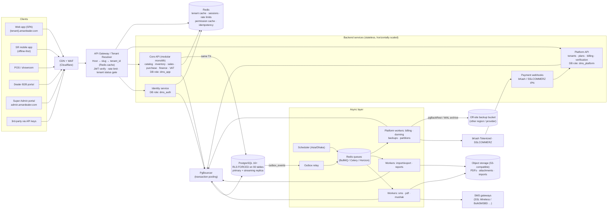
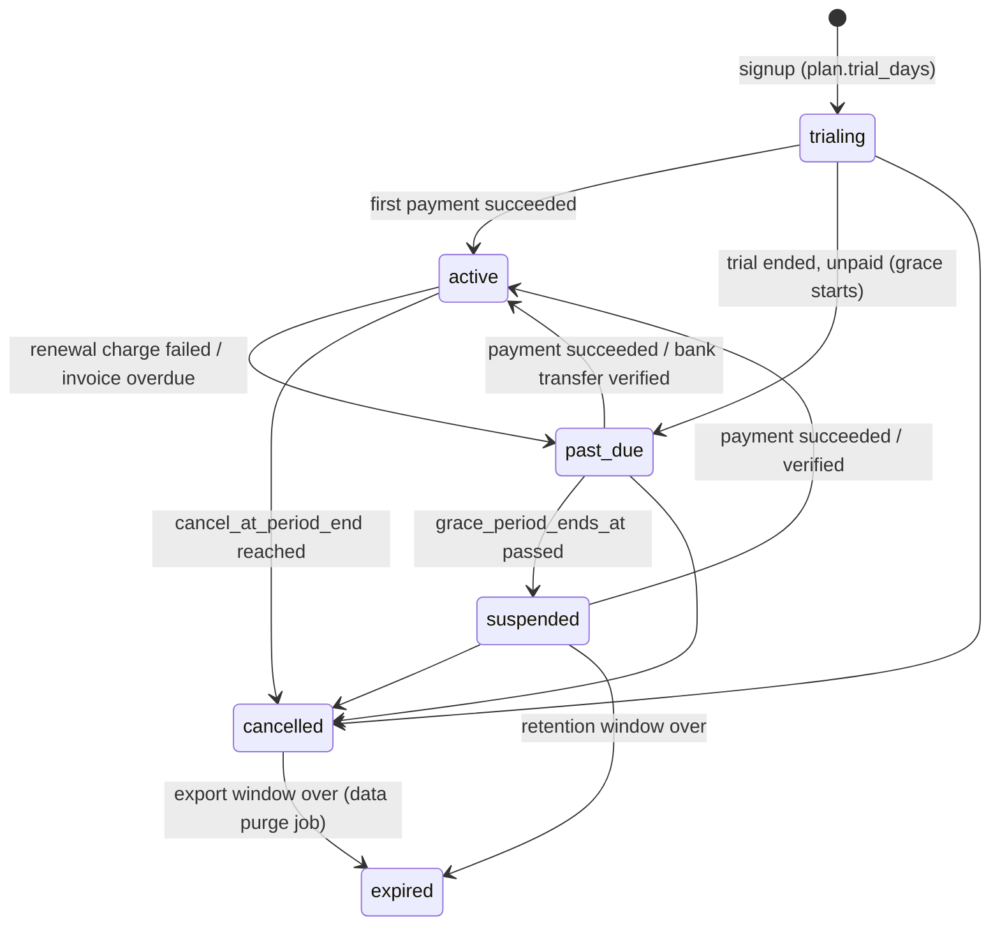

# AmarDealer DMS: System Architecture

A multi-tenant Dealership / Distribution Management SaaS for Bangladesh. It is built to work for any product business, from motorbike dealers and mobile distributors to FMCG, pharma, apparel, building materials, agro inputs, furniture and general trading. **No vertical-specific columns exist in the core tables.** Vertical behaviour comes from configuration data (see §5).

| Artifact | Path |
|---|---|
| Full DDL (ordered migrations 00 → 12) | [db/schema.sql](../db/schema.sql) → [db/schema/](../db/schema/) |
| Reference data: plans, features, permissions, industry templates, BD divisions, SMS templates | [db/seed/reference_data.sql](../db/seed/reference_data.sql) |
| Isolation / limits / stock / ledger / numbering / audit tests (run as `dms_app`) | [db/tests/smoke_test.sql](../db/tests/smoke_test.sql) |
| Two-session oversell race test | [db/tests/concurrency_oversell.sh](../db/tests/concurrency_oversell.sh) |

Verified on PostgreSQL 18 (requires 15+ for `UNIQUE NULLS NOT DISTINCT`): 102 tables, 93 under forced RLS, and all smoke and concurrency tests pass.

---

## 1. Design principles

1. **Shared database, shared schema, `tenant_id` on every tenant row, RLS forced.** The database rejects cross-tenant access even when application code has a bug.
2. **Composite foreign keys `(tenant_id, x_id) → parent(tenant_id, id)`.** FK checks bypass RLS, so a plain FK would let tenant B attach a row to tenant A's branch if it guessed the UUID. The composite FK makes that impossible (tested: SQLSTATE 23503).
3. **Ledgers are the truth; balances are projections.** `stock_movements` and `payments_ledger` are append-only. Triggers maintain `stock_balances`, `customers_dealers.current_due_balance` and `suppliers.current_payable_balance` under row locks.
4. **Invariants live in the database.** These include no negative stock, no serial sold twice, no duplicate chassis/IMEI, plan limits, gapless Mushak numbers and an immutable audit trail. The API checks them as well to produce friendly errors, but the DB is the last line of defence.
5. **Configuration over code for verticals.** Product types, tracking modes, units, variants, identifier types, custom fields, settings and modules are all data.

---

## 2. High-level architecture



ASCII fallback:

```
 Web / SR app / POS / B2B / API keys        Super Admin
              │                                  │
        CDN + WAF ──────────────────────────────┘
              │
   API Gateway / Tenant Resolver ── Redis (tenant cache, sessions, rate limit)
     │ host → slug → tenant_id, JWT.tid == host tenant, tenant.status gate
     ├── Identity svc (dms_auth) ───────┐
     ├── Core API     (dms_app)  ───────┼── PgBouncer ── PostgreSQL (RLS FORCED)
     └── Platform API (dms_platform) ───┘                     │ outbox_events
                                                              ▼
           Scheduler ──► Redis queues ◄── Outbox relay
                              │
          ┌───────────────────┼─────────────────────┐
      sms / pdf / mushak   import / reports    billing / dunning / backups
          │                   │                     │
     SMS gateway        Object storage        bKash · SSLCOMMERZ · off-site backups
```

The core API is a **modular monolith**. Modules share one DB and one transaction, which posting an invoice requires: stock, ledger, VAT challan and number in a single ACID unit. Extract services only when a module has an independent scaling need, with reporting and SMS as the likely first candidates.

---

## 3. Multi-tenancy & Row-Level Security

### 3.1 Database roles

| Role | RLS | Used by | Can do |
|---|---|---|---|
| `dms_owner` | BYPASS | migrations only | owns all objects |
| `dms_app` | **enforced** | Core API | DML on tenant tables. Read-only on plans/limits/subscriptions. No `password_hash`. Append-only ledgers |
| `dms_worker` | **enforced** | tenant-scoped jobs | same as `dms_app` |
| `dms_auth` | BYPASS | identity service | `users` R/W; read memberships/tenants/roles for login, the workspace switcher and the tenant resolver |
| `dms_platform` | BYPASS | Super Admin, billing, backups | everything except rewriting ledgers/audit |

`BYPASSRLS` is a role attribute that **is not inherited** through `GRANT role`, so each one is its own LOGIN role.

### 3.2 Policy

Every tenant table gets exactly this ([12_security_rls.sql](../db/schema/12_security_rls.sql)):

```sql
ALTER TABLE invoices ENABLE ROW LEVEL SECURITY;
ALTER TABLE invoices FORCE  ROW LEVEL SECURITY;      -- applies to the owner too
CREATE POLICY tenant_isolation ON invoices AS PERMISSIVE FOR ALL TO dms_app, dms_worker
  USING      (tenant_id = current_tenant_id())
  WITH CHECK (tenant_id = current_tenant_id());

-- current_tenant_id() = NULLIF(current_setting('app.current_tenant_id', true), '')::uuid
```

* **Fails closed.** With no context the function returns NULL, `tenant_id = NULL` is never true, reads return 0 rows and every insert fails (tested).
* `tenant_id` is denormalized onto every child row (`invoice_items`, `grn_items` …), so policies never join and the btree on `(tenant_id, …)` serves both RLS and the query.
* Special policies cover `tenants` (own row only, whitelisted updatable columns), `users` (self plus co-members), the read-only platform tables, `subscription_payments` (the tenant may only *submit* with status `initiated`/`pending_verification`), `notification_templates` (global defaults readable, overrides private) and `audit.audit_logs` (select only).
* **Migration self-check.** The last block of `12_security_rls.sql` aborts if any table with a `tenant_id` column lacks forced RLS and a policy. Keep that block at the end of every future migration.

### 3.3 Setting the tenant per request (middleware)

The context is set **transaction-locally** (`set_config(..., true)` ≡ `SET LOCAL`), so it disappears on COMMIT/ROLLBACK and cannot leak to the next request on a pooled connection. This also makes it safe with PgBouncer in transaction mode. Never use session-level `SET`.

```ts
// Framework-agnostic pseudo-code (NestJS interceptor / Laravel middleware / Django middleware / Go handler)
async function withTenantTx<T>(req, work: (tx) => Promise<T>): Promise<T> {
  const tenant = req.tenant;            // resolved by gateway from Host header, status already checked
  const user   = req.auth;              // verified JWT; MUST satisfy user.tid === tenant.id
  return db.transaction(async (tx) => {
    await tx.query(
      `SELECT set_config('app.current_tenant_id', $1, true),
              set_config('app.current_user_id',   $2, true),
              set_config('app.tenant_timezone',   $3, true),
              set_config('app.request_id',        $4, true),
              set_config('app.client_ip',         $5, true),
              set_config('app.actor_type',        $6, true),
              set_config('app.impersonator_user_id', $7, true)`,
      [tenant.id, user.id, tenant.timezone, req.id, req.ip, user.actorType, user.impersonatorId ?? '']);
    return work(tx);                    // every query of the request runs inside this TX
  });
}
```

Rules for the codebase:

1. The **only** way to get a DB handle in request code is `withTenantTx`. Lint against the raw pool.
2. Workers receive `tenant_id` in the job payload and call the same wrapper. Platform jobs use the `dms_platform` pool.
3. Use one integration test per repository that runs as `dms_app` with tenant B and asserts it sees none of tenant A's rows ([smoke_test.sql §4](../db/tests/smoke_test.sql)).

### 3.4 Defence in depth

| Layer | Stops |
|---|---|
| Gateway: JWT `tid` must equal the Host's tenant | token replay across subdomains |
| `SET LOCAL` per transaction | context leaking through the pool |
| RLS `USING` / `WITH CHECK`, `FORCE` | reads/writes of other tenants' rows, including from owner-run code |
| Composite `(tenant_id, id)` FKs | linking to another tenant's row by UUID |
| Column grants on `users` / `tenants` | reading password hashes, changing slug/status/plan |
| Migration RLS self-check | a new table shipped without a policy |
| Separate BYPASSRLS roles for auth/platform | the tenant API cannot elevate itself |

---

## 4. Tenant routing & identity

* **Subdomain routing.** `{slug}.amardealer.com` → gateway reads `Host` → Redis `tenant:host:{host}` (TTL 5 min, invalidated by the `subscription.status_changed` outbox event) → miss → `dms_auth` query `SELECT id, status, timezone FROM tenants WHERE slug = $1 OR custom_domain = $1`. Reserved slugs (`www`, `app`, `admin`, `api` …) are blocked by a CHECK.
* **Central login and workspace switcher.** `app.amardealer.com/login` (email or BD phone + OTP for field SRs). The identity service lists `tenant_memberships WHERE user_id = $1 AND status = 'active'`. One `users` row serves many tenants. Selecting a workspace issues a short-lived **tenant-scoped JWT** (`sub`, `tid`, `mid`, `perm_ver`) and redirects to the subdomain. Permissions are resolved from `membership_roles → role_permissions` and cached in Redis by `perm_ver`.
* **RBAC.** The global `permissions` catalog (65 codes, `module.resource.action`) maps to per-tenant `roles` (seeded from the industry template, fully editable) and then to `membership_roles`. A role is optionally **scoped to a branch** (`branch_id`). `roles.data_scope` (`tenant | branch | territory | own`) drives row filtering *within* a tenant in the API. For example, an SR sees only their own customers.
* **Tenant status gate** (per request, from cache): `active` gives full access; `read_only` (cancelled) allows GET and export only; `suspended` allows only `/billing` and `/export`; `closed` gets 410.
* **Super Admin portal** (`admin.amardealer.com`, separate deployment, IP allow-list + mandatory MFA, `platform_admins` table) covers tenant CRUD, plan and price management, per-tenant limit overrides (`tenant_feature_limits.source='override'` with reason and expiry), manual bank-transfer verification queue, suspend/reactivate, usage dashboards, and **impersonation**. Impersonation runs a tenant session with `app.actor_type='platform_admin'` and `app.impersonator_user_id`, and every audited row records it.

---

## 5. Business & product flexibility model

These levers let one schema serve any product business:

| Lever | Where | What it covers |
|---|---|---|
| **Product type** | `products.product_type` | `stockable`, `consumable`, `service` (installation, servicing, registration fee), `bundle` (bike + helmet + registration), `digital` |
| **Tracking mode** | `products.tracking_mode` | `none` (cement, oil), `batch` (FMCG, pharma, with expiry/FEFO), `serial` (bikes, phones), `batch_and_serial` |
| **Configurable unit identifiers** | `serial_identifier_types` + `product_identifier_requirements` + `product_serial_identifiers` | Any number of identifiers per unit, each with regex, normalisation and Luhn check: chassis + engine + key (motorbike), IMEI1 + IMEI2 (phones), serial + MAC (IT), machine serial (agro). Uniqueness is per identifier type across the whole tenant |
| **Variants** | `products.variant_attributes` + `product_variants.variant_options` (jsonb) | Any axes: color × storage, size × color × fit, material × size, engine CC × color. Every transaction references `variant_id`; simple products get one default variant |
| **Units of measure** | `units` + `product_uoms.factor_to_base` | pcs/ctn/dozen, kg/bag/ton, litre/ml, yard/metre, sqft/cft, strip/box. Quantities are `NUMERIC(18,4)` and stock is held in the base unit |
| **Custom fields** | `custom_field_definitions` + `custom_fields jsonb` on 15 tables, GIN-indexed | Typed (text/number/date/select/multi-select/file/reference), required/unique/searchable, optionally limited to a **category subtree**, `show_on_print` for invoices/challans. Examples: BRTA registration no., DGDA DAR no., generic name, BSTI licence, outlet type, project site |
| **Hierarchies** | `territories`, `categories` with `ltree` paths, any depth | Zone › Region › Area › Territory › Market for FMCG, Division › Dealer zone for automotive. Subtree queries via `path <@` |
| **Channel tiers** | `customer_groups.tier_level` + `customers_dealers.parent_customer_id` | Distributor › dealer › sub-dealer › retailer, each tier with its own price list, credit defaults and discount |
| **Pricing** | `price_lists` (per tier / branch / validity / tax-inclusive) + `price_list_items` (qty breaks, min price) | Dealer vs retail vs corporate pricing, festival prices, floor price with approval |
| **Promotions** | `promotions.promotion_type` + typed `rules` / `eligibility` / `applies_to` jsonb | % / amount off, buy-X-get-Y (FMCG), slab discounts, free gift, bundle price, cashback, targeted by group/territory/channel |
| **Payment modes** | `invoices.payment_mode` + `emi_plans` / `installment_schedules` | Cash, credit (credit limit and days), in-house EMI (flat / reducing / zero interest, late fees, guarantor), mixed |
| **Taxes** | `tax_rates` → `tax_groups` (sequenced, compound) | VAT 15/10/7.5/5 %, SD before VAT, exempt, zero-rated, turnover tax, AIT/AT on imports |
| **Warehouse types** | `warehouses.warehouse_type` | main, showroom, **van** (SR van sales), consignment, damaged, quarantine, transit, service |
| **Stock deduction point** | setting `inventory.deduct_stock_on` | `invoice` (showroom) or `delivery` (distribution, building materials) |
| **Settings** | `tenant_settings` (key → jsonb) | costing method, FEFO/FIFO, credit check `warn`/`block`, require serial on invoice, block expired sale, geofence radius, print templates, enabled modules |
| **Modules / plan toggles** | `feature_catalog` → `plan_features` → `tenant_feature_limits` | `module.serial_tracking`, `module.batch_expiry`, `module.emi`, `module.sales_force`, `module.van_sales`, `module.import_lc`, `module.warranty`, `module.b2b_portal` … New feature = new row |
| **Approvals** | `approval_rules` / `approval_requests` | Credit over-limit, discount > X %, price < min, PO > amount, stock adjustment, invoice void, each routed to a role |
| **Numbering** | `document_number_formats` | Per document type and per branch, tokens `{PREFIX} {BR} {FY} {YYYY} {MM} {SEQ}`, reset never / fiscal-year / yearly / monthly |
| **Industry templates** | `industry_templates.config` | One-click onboarding preset (below); everything remains editable |

### 5.1 Shipped industry templates

| Template | Tracking | Identifiers | Units | Enabled modules / settings | Example custom fields |
|---|---|---|---|---|---|
| `motorbike_automotive` | serial | chassis*, engine*, key | pcs, set, ltr | EMI, warranty, import/LC, specific-identification cost, credit `block` | engine cc, model year, color, BRTA status, registration no., free-service coupons |
| `electronics_mobile` | serial + variants | IMEI1*, IMEI2 (Luhn), serial, MAC | pcs, box | EMI, warranty, sales force, promotions | BTRC approval no., model no. |
| `fmcg_distribution` | batch/expiry | none | pcs, ctn, dz, pkt, kg, ltr | sales force, van sales, promotions, FEFO, deduct on delivery | pack size, BSTI licence, outlet type, has visicooler |
| `pharmaceuticals` | batch/expiry (mandatory) | none | strip, box, bottle, vial | FEFO, block expired sale, near-expiry 90 d | generic name, strength, dosage form, DGDA DAR no., drug licence (customer) |
| `apparel_footwear` | variants | none | pcs, pair, yard, metre | variant matrix, POS | fabric, season (Eid / Puja / winter) |
| `building_materials` | none / batch | none | bag, ton, kg, sqft, cft, ltr | deduct on delivery, credit `block`, approvals | grade, truck capacity, project site |
| `agro_inputs` | batch + serial (machinery) | machine serial | kg, bag, pkt, ltr | FEFO, seasonal schemes | crop (multi-select), registration no. |
| `furniture_home` | serial + variants | serial | pcs, set | EMI, warranty, advance on order | dimensions, installation required |
| `general_trading` | none | none | pcs, box, kg | neutral baseline | – |

### 5.2 Adding a new vertical needs no migration

Example: a **solar panel & battery distributor**.

1. Insert an `industry_templates` row with identifier types `panel_serial` and `battery_serial`, units `pcs` and `watt`, custom fields `wattage_wp` and `battery_ah` (product) and `installation_site` (invoice), and modules `serial_tracking`, `emi`, `warranty`.
2. Onboard the tenant with it. Existing tables, posting logic, reports, RLS and audit apply unchanged.

Promote a jsonb custom field to a real column only when it needs FK integrity or heavy aggregation.

---

## 6. Bangladesh localization

| Concern | Implementation |
|---|---|
| Money | Domain `amount_t = NUMERIC(15,2)` for BDT totals/balances. `price_t = NUMERIC(15,4)` for unit prices/costs (per-gram/ml). Rounding happens per line, and `round_off` sits on the invoice. Never float |
| Foreign currency | `currency` + `exchange_rate` on POs, GRNs and supplier bills (USD/CNY/INR imports). Inventory cost is always BDT (`landed_unit_cost`) |
| Time | All instants are `TIMESTAMPTZ` (UTC storage). Business dates are `DATE` computed by `tenant_today()` in `tenants.timezone` (default `Asia/Dhaka`, UTC+6, no DST). Monthly usage periods and cron schedules use Dhaka time |
| Fiscal year | `tenants.fiscal_year_start_month = 7` (July–June). `{FY}` token yields `2627` for FY 2026-27 and numbering resets per FY |
| NBR identity | `bin_t` (9 or 13 digit), `tin_t` (12-digit e-TIN), `nid_t` (10/13/17), trade licence. Unit-registered branches carry `vat_unit_bin` |
| Mushak | `vat_challans`: **6.3** tax invoice, **6.5** inter-branch transfer, **6.6** VDS certificate, **6.7** credit note (sales return), **6.8** debit note (purchase return). Seller/buyer snapshot, gapless per type and branch, cancel with reason. Registers 6.1/6.2 and return 9.1 are reports over `vat_challans`, `invoice_items` and `supplier_bills` (input VAT, VDS) |
| Taxes | VAT standard/reduced, SD, AIT, AT, customs/regulatory duty. Import duties are capitalized via `purchase_landed_costs` (recoverable VAT/AT excluded from cost) |
| Language | `name_bn` / `label_bn` columns on user-facing masters. SMS templates default to Bangla (UCS-2, 70 chars per segment tracked in `sms_messages.segments`) |
| Phones | E.164 domain `phone_t` (`+8801XXXXXXXXX`). The API normalises `01XXXXXXXXX` input |
| Payments | `payments.method` includes bKash, Nagad, Rocket, Upay, NPSB, BEFTN, RTGS, cheque (with clearance lifecycle) and pay order |
| Geography | `geo_areas` division › district › upazila/thana › union (BBS codes). 8 divisions are seeded; load the full BBS file at deploy |

---

## 7. Subscription billing



* Transitions go **only** through `transition_subscription()`. It locks the row, rejects illegal edges (`DL060`), writes `subscription_status_history`, sets `tenants.status` and emits an outbox event that invalidates the gateway cache. Only `dms_platform` may execute it (tested).
* Effect on the tenant: `past_due` keeps full access with a banner, `suspended` allows billing and export only, `cancelled` is read-only, `expired` is closed.
* **bKash Tokenized Checkout (auto-renew).** Create Agreement → store `agreementID` in `tenant_payment_methods.gateway_token_ref` (encrypted). On renewal day the billing worker creates a `subscription_invoices` row and a `subscription_payments` row (`initiated`, idempotency key), calls Create Payment with the agreement, then Execute. Query Payment is the source of truth when a callback is lost.
* **SSLCOMMERZ.** A hosted checkout link per invoice is sent by SMS/email. The IPN lands in `payment_gateway_events`, deduped by `(gateway, event_id)`, validated with the validation API and signature, then settled.
* **Manual bank transfer.** The tenant uploads the slip, which inserts `subscription_payments` with `status='pending_verification'` (RLS allows only that status). It enters the Super Admin verification queue (`ix_sub_payments_verify_queue`). On approval it moves to `succeeded`, the invoice to `paid`, and `transition_subscription(..., 'active')` runs. Rejection requires a reason.
* **Dunning** (daily 10:00 Dhaka): retry tokenized charges on day 0/3/5, SMS + email reminders, move to `suspended` when `grace_period_ends_at` passes.
* **Plan change.** `sync_tenant_limits_from_plan()` re-materializes limits but keeps unexpired Super Admin overrides. On a downgrade, existing rows stay and only *new* creations above the limit are blocked.

---

## 8. Background jobs

The **transactional outbox** (`outbox_events`) is written in the same transaction as the business change, and a relay pushes it to Redis queues. "Invoice committed" therefore always implies "PDF + SMS job enqueued", with no dual-write gap. Workers are idempotent (keyed by the event id) and wrap tenant work in `withTenantTx(job.tenant_id)`.

| Queue | Producer | Work | Notes |
|---|---|---|---|
| `sms` | `invoice.posted`, `payment.posted`, reminders, campaigns | render `notification_templates` (tenant override → platform default), send, update `sms_messages` | per-tenant and per-provider rate limits, `consume_usage('max_monthly_sms', segments)`, provider failover, DLR webhook |
| `pdf` | invoice / challan / statement events | HTML → PDF (Gotenberg/Puppeteer), store in object storage, set `pdf_file_key` | Bangla font embedding (Kalpurush/SolaimanLipi) |
| `mushak` | invoice / transfer / return posting | build the 6.3/6.5/6.7/6.8 snapshot and PDF | monthly 6.1/6.2 register export |
| `import` / `export` | `import_jobs` | validate → upsert in chunks, error report file | runs as `dms_worker` under RLS |
| `reports` | scheduled / on demand | heavy aggregates on the **read replica** | |
| `billing` (platform) | scheduler | renewals, dunning, invoice generation | `dms_platform` |
| `maintenance` (platform) | scheduler | `audit.ensure_partition(+1..3 months)`, expire overrides, refresh `sales_targets.achieved_value` | |
| `backup` (platform) | scheduler 02:00 Dhaka | pgBackRest full weekly + incremental daily, continuous WAL archiving to an **off-site** bucket (different provider/region), encrypted. Monthly automated restore test logged in `backup_runs`. Per-tenant export (CSV/JSON zip) on request or cancellation | RPO ≈ minutes (WAL), RTO < 1 h |

Nightly tenant jobs (Dhaka time): mark overdue installments and add late fees, overdue-credit SMS, near-expiry batch alerts, low-stock alerts, cheque-date reminders.

---

## 9. Module → table map

| Module | Tables |
|---|---|
| SaaS & subscription | `plans`, `plan_prices`, `plan_features`, `feature_catalog`, `tenants`, `tenant_feature_limits`, `tenant_usage_counters`, `tenant_settings`, `subscriptions`, `subscription_status_history`, `subscription_invoices`, `subscription_payments`, `tenant_payment_methods`, `payment_gateway_events`, `industry_templates`, `backup_runs` |
| Identity, RBAC, org | `users`, `platform_admins`, `tenant_memberships`, `roles`, `permissions`, `role_permissions`, `membership_roles`, `branches`, `warehouses`, `warehouse_locations`, `territories`, `geo_areas` |
| Catalog | `units`, `categories`, `brands`, `products`, `product_uoms`, `product_variants`, `product_barcodes`, `product_bundle_items`, `custom_field_definitions`, `tax_rates`, `tax_groups`, `tax_group_rates`, `price_lists`, `price_list_items`, `promotions` |
| Serialized / batch inventory | `serial_identifier_types`, `product_identifier_requirements`, `product_batches`, `product_serials`, `product_serial_identifiers`, `stock_balances`, `stock_movements`, `stock_transfers`, `stock_transfer_items`, `stock_transfer_item_serials`, `stock_adjustments`, `stock_adjustment_items` |
| Customers, SR, credit | `parties`, `party_addresses`, `customer_groups`, `customers_dealers`, `sales_reps`, `sales_rep_territories`, `routes`, `route_customers`, `sales_targets`, `sr_visits` |
| Sales | `sales_orders`, `sales_order_items`, `invoices`, `invoice_items`, `invoice_item_serials`, `deliveries`, `delivery_items`, `emi_plans`, `installment_schedules`, `installment_schedule_items`, `sales_returns`, `sales_return_items`, `warranty_claims`, `approval_rules`, `approval_requests`, `document_number_formats`, `document_sequences` |
| Money | `financial_accounts`, `payments`, `payment_allocations`, `payments_ledger` |
| Procurement | `suppliers`, `purchase_orders`, `purchase_order_items`, `goods_received_notes`, `grn_items`, `purchase_landed_costs`, `supplier_bills`, `purchase_returns`, `purchase_return_items` |
| VAT / compliance | `vat_challans`, `audit.audit_logs` (monthly partitions) |
| Services | `attachments`, `notification_templates`, `sms_messages`, `outbox_events`, `api_keys`, `import_jobs` |

---

## 10. Critical transaction flows

All flows run in one transaction at READ COMMITTED with explicit row locks, inside `withTenantTx`.

### 10.1 Posting an invoice with serialized stock (no oversell)

**Lock order (identical in every flow, which prevents deadlocks):**
usage counter → customer → serials (ORDER BY id) → stock balances (ORDER BY warehouse, variant, batch) → document sequence (last).

```sql
BEGIN;  -- + set_config(...) context
-- 0. draft invoice + items already exist (status 'draft', no number yet)

-- 1. Credit control: lock the customer row, re-read the balance under the lock
SELECT current_due_balance, credit_limit, credit_status
  FROM customers_dealers WHERE id = :customer FOR UPDATE;
--    due + total > limit  → abort with CREDIT_LIMIT_EXCEEDED, or require an
--    approved approval_requests row (invoices.credit_override_approval_id)

-- 2. Claim the exact units. The conditional UPDATE is the lock AND the check.
WITH claimed AS (
  UPDATE product_serials
     SET status = 'sold', warehouse_id = NULL, sold_invoice_id = :inv,
         sold_to_customer_id = :customer, sold_at = now(),
         warranty_starts_on = tenant_today(), warranty_ends_on = tenant_today() + :warranty,
         version = version + 1
   WHERE tenant_id = current_tenant_id()
     AND id = ANY(:serial_ids)             -- pre-sorted
     AND warehouse_id = :warehouse
     AND (status = 'in_stock' OR (status = 'reserved' AND reserved_for_order_id = :order))
  RETURNING id, unit_cost)
SELECT count(*), sum(unit_cost) FROM claimed;
--    count <> requested → ROLLBACK, SERIAL_NOT_AVAILABLE (list which ones)

-- 3. Link units to lines. The partial unique index ux_invoice_item_serials_active
--    (tenant_id, serial_id) WHERE is_active is the last-resort guard.
INSERT INTO invoice_item_serials (...);

-- 4. Stock ledger. The trigger locks the balance row and decrements it.
--    CHECK stock_balances_non_negative rejects the row if it would go below 0.
INSERT INTO stock_movements (... quantity = -1, serial_id, unit_cost = serial cost ...);

-- 5. Party ledger. The trigger updates current_due_balance and sets balance_after.
INSERT INTO payments_ledger (party_role 'customer', entry_type 'invoice', debit = grand_total ...);
--    + payments / payment_allocations for the cash part, installment_schedules for EMI

-- 6. VAT challan 6.3 + gapless numbers (row-locked sequences), LAST to keep the hot lock short
UPDATE invoices SET invoice_no = next_document_number('invoice', branch_id, invoice_date),
                    status = 'posted', posted_at = now(), ... WHERE id = :inv;
--    AFTER trigger: consume_usage('max_monthly_invoices') (plan limit)
INSERT INTO outbox_events (event_type 'invoice.posted', ...);
COMMIT;
```

**Why two concurrent sales of chassis `CH0002` cannot both succeed:** session 2's `UPDATE … WHERE status = 'in_stock'` blocks on session 1's row lock. When session 1 commits, PostgreSQL re-evaluates the `WHERE` against the new row version (EvalPlanQual), sees `sold`, and returns **0 rows**, so session 2 aborts cleanly. If session 1 rolls back, session 2 gets the unit. [concurrency_oversell.sh](../db/tests/concurrency_oversell.sh) demonstrates exactly this: S2 waits about 2 s and then claims 0 units.

Variants of the flow:

* **Scan-less auto-pick** (FIFO by received date): `SELECT id FROM product_serials WHERE … status='in_stock' ORDER BY received_at LIMIT :n FOR UPDATE SKIP LOCKED`. Concurrent cashiers take *different* units instead of queueing.
* **Fail fast in the UI**: `SELECT … FOR UPDATE NOWAIT` returns 55P03 immediately, which the API reports as "unit is being sold at another counter".
* **Non-serialized / batch stock**: no serial step. The `stock_movements` trigger locks `stock_balances` and the CHECK constraint rejects overselling (tested in both single-session and concurrent runs). FEFO picks batches with `ORDER BY expires_on`.
* **Sales-order reservation**: approving an order sets `product_serials.status='reserved'` (+ `reserved_until`), or increments `stock_balances.qty_reserved` under the same lock. Invoicing then consumes the reservation. A nightly job releases expired reservations.
* **Offline SR app**: every mutation carries `client_ref`. `UNIQUE (tenant_id, client_ref)` makes retries idempotent, so a duplicate submit returns the existing document.

### 10.2 Enforcing plan limits (e.g. blocking a new branch)

Enforced **inside PostgreSQL** by `enforce_plan_limit()` AFTER INSERT/UPDATE triggers on `branches`, `warehouses`, `tenant_memberships`, `product_variants` and `sales_reps`. No code path, including imports, scripts or a forgotten endpoint, can bypass it.

```
INSERT INTO branches (...)                      -- row written (not yet visible to others)
  └─ AFTER trigger (SECURITY DEFINER)
       SELECT limit_value FROM tenant_feature_limits
        WHERE tenant_id = NEW.tenant_id AND feature_key = 'max_branches'
        FOR UPDATE;                             -- per-tenant mutex for this feature
       SELECT count(*) FROM branches WHERE tenant_id = … AND is_active;   -- includes NEW row
       count > limit  →  RAISE SQLSTATE 'DL001' 'PLAN_LIMIT_REACHED:max_branches'
```

* **Race safety.** Two simultaneous "create branch" requests serialize on the limit row. The second one's count statement takes a new snapshot after the first commits (READ COMMITTED), sees both rows and fails. Without the lock both could count `0 < 1` and succeed.
* Reactivating a deactivated record is guarded too (`UPDATE OF is_active` trigger, tested).
* **Metered limits** (`max_monthly_invoices`, `max_monthly_sms`) use `consume_usage()`. An atomic `INSERT … ON CONFLICT DO UPDATE SET used = used + n RETURNING used` on `tenant_usage_counters` locks the counter row, and the limit check raises `DL001`, which rolls the increment back with the transaction. Periods are calendar months in the tenant's timezone.
* Module toggles (`is_enabled = false`) raise `DL002 FEATURE_DISABLED`. The API also checks toggles up front to hide UI.
* The API maps `DL001` to HTTP 402/403 `{ code: "PLAN_LIMIT_REACHED", feature, limit, upgrade_url }`.

### 10.3 Other flows (summary)

| Flow | Key mechanics |
|---|---|
| GRN posting | Create `product_batches` / `product_serials` + identifiers (unique per type → duplicate chassis/IMEI rejected), allocate `purchase_landed_costs` into `grn_items.landed_unit_cost`, insert `stock_movements` (+qty, cost) which updates the moving average, then the supplier ledger credit on bill posting |
| Stock transfer | Dispatch: serials → `in_transit`, `transfer_out` movements, Mushak 6.5 if VAT units differ. Receive: `transfer_in` at destination at the dispatched cost; partial receipt supported |
| Payment receipt | Lock customer → insert `payments` → `payment_allocations` oldest-first (or chosen) → update `invoices.paid_amount/payment_status` and installment items → ledger credit. A bounced cheque posts a reversing `cheque_bounce` debit |
| Void / return | Never delete. Void writes reversing stock movements and ledger entries, sets `invoice_item_serials.is_active = false` and returns serials to `in_stock` (or `defective`). A return issues Mushak 6.7 |
| Numbering | `next_document_number()` upserts the `(tenant, format, branch, period)` row, so a rollback returns the number. This keeps it gapless as NBR expects |

---

## 11. Audit & compliance

* `audit.audit_logs` is **range-partitioned by month**. Row triggers on about 50 financial, stock, pricing, credit and access-control tables capture `old_data`, `new_data`, `changed_fields`, actor, impersonator, request id, IP, DB role and txid. No-op updates are skipped.
* Business events (`POST`, `VOID`, `LOGIN`, `EXPORT`, `IMPERSONATE`, `PRICE_OVERRIDE`) are written via `audit.log_event()`. Its `tenant_id` is forced from the session and never taken from the caller.
* **Immutability** has three layers: app roles have SELECT only, every write goes through SECURITY DEFINER functions, and triggers block UPDATE/DELETE/TRUNCATE even for the owner (tested `DL010`). Retention works by detaching old partitions to WORM / cold storage (NBR record keeping is ≥ 6 years). Ship partitions nightly to the off-site bucket for tamper evidence.
* `stock_movements` and `payments_ledger` are themselves append-only (grants + trigger). Corrections are reversal rows (`reversal_of_id`, unique per original).

---

## 12. Running & testing

```bash
createdb amardealer_test
psql -v ON_ERROR_STOP=1 -d amardealer_test -f db/schema.sql
psql -v ON_ERROR_STOP=1 -d amardealer_test -f db/seed/reference_data.sql
psql -v ON_ERROR_STOP=1 -d amardealer_test -f db/tests/smoke_test.sql          # 40 assertions
PSQL="psql -d amardealer_test" ./db/tests/concurrency_oversell.sh
```

Schema files need a superuser (or `dms_owner` with CREATEROLE) because `00_foundation.sql` creates the roles. Set passwords afterwards with `ALTER ROLE … PASSWORD`.

## 13. Open decisions

* **Backend framework.** The schema is framework-agnostic. The one hard requirement is a per-request transaction wrapper that runs `set_config(..., true)` (§3.3). With an ORM, use its transaction hook: Prisma `$transaction` + `$executeRaw`, TypeORM `QueryRunner`, Laravel `DB::transaction` + `DB::statement`, Django `transaction.atomic` + `connection.cursor()`, Go `pgx.BeginFunc`.
* **General ledger.** `payments_ledger` is a party sub-ledger. A full double-entry GL (chart of accounts, journals, trial balance) can be added as a module that subscribes to the same posting events.
* **Scale path.** Partition `stock_movements`, `payments_ledger` and `sms_messages` by month once they pass about 50 M rows. Move very large tenants to a dedicated database with the same schema; the gateway already resolves the tenant first, so routing to a different connection string is a lookup change.
